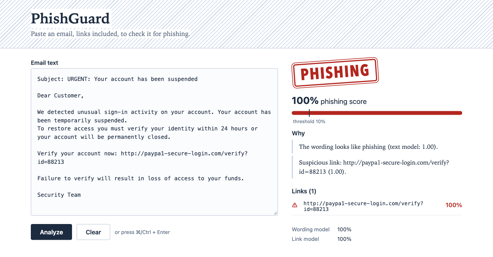
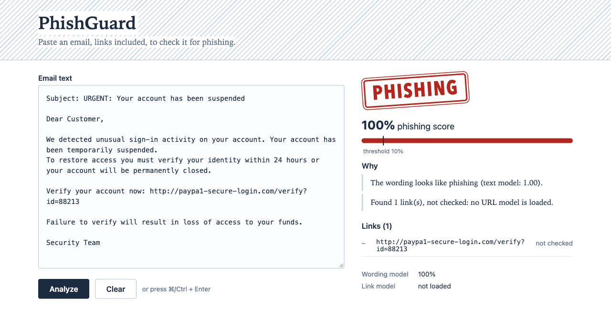

# PhishGuard — Report

*Machine Learning Project, Artificial Intelligence. Milton Adina.*

## 1. What I built and why

Phishing usually arrives by email, and small businesses rarely have a security team to catch it. The person who opens a fake invoice or an "account suspended" warning is often the person who pays the bills. I wanted a tool that person could use: paste a suspicious email and get a clear answer, with reasons.

The approved proposal:

> *A two-stage phishing email detector served through a small web app. A user pastes an email and gets a phishing score, any flagged links, and a short reason.*

PhishGuard does this in two stages:

- **Stage 1 (the wording):** DistilBERT, a pretrained transformer, fine-tuned on 65,510 labelled emails. It reads the email text and gives P(phishing).
- **Stage 2 (the links):** a small character-level convolutional network (CNN) trained on 188,296 labelled URLs. It scores every link in the email.
- **Fusion:** the two scores are combined with a weight and threshold fitted on the validation split. The result is a verdict and plain-English reasons.
- **App:** a FastAPI server with a one-page UI and a JSON API (`POST /api/analyze`).

A TF-IDF + logistic regression **baseline** is trained on the same data. It is not part of the app; it only shows what fine-tuning gained. A **held-out set** of 2,000 emails from a different source, never used for training or tuning, checks whether the models generalise.

```
                     ┌──────────────────────────────────────────────┐
 raw email text ───► │ data.extract_urls()   data.clean_text()      │
                     └───────┬──────────────────────┬───────────────┘
                             │ urls (≤ 20)          │ cleaned text
                             ▼                      ▼
                 ┌──────────────────┐    ┌──────────────────────┐
                 │ Stage 2: URL     │    │ Stage 1: text        │
                 │ char-CNN         │    │ fine-tuned DistilBERT│
                 └────────┬─────────┘    └──────────┬───────────┘
                 per-URL P(phish)          P(phish) for the text
                          │  max over URLs          │
                          └──────────┬──────────────┘
                                     ▼
                      ┌─────────────────────────────┐
                      │ fuse(weight) → verdict,     │
                      │ reasons                     │
                      └──────────────┬──────────────┘
                                     ▼
                     PhishDetector.analyze() → FastAPI + web page
```

The page with both models loaded. The email is flagged, the reasons say why, and the link is marked suspicious:



**What the live demo shows, and why it differs from the proposal.** Both stages are built, trained, tested and wired into the app. The screenshot above is the full two-stage system. But the URL model learned a shortcut from its training data (section 4): it flags almost every real link, including `github.com` and `python.org`. When the fusion weight was fitted on real validation emails, the search gave the URL model **no weight** (text weight 1.0), so it never changes a verdict. It would still print "Suspicious link" next to harmless links, though, so the live demo runs in text-only mode (`make demo`). Links are listed but marked "not checked":



This goes beyond a basic model in four ways: it fine-tunes a pretrained transformer, combines two models in a multi-stage system, serves them in a working app, and tests them on data from a source they never saw.

## 2. Why these technologies

**PyTorch** (over TensorFlow/Keras). Hugging Face Transformers, which provides DistilBERT, is built around PyTorch. PyTorch also runs on the Mac's GPU through Apple's MPS backend. The fine-tuning loop is written out by hand rather than using the Transformers `Trainer`. It uses AdamW, a 10% warmup then linear decay, gradient clipping at 1.0, validation F1 after every epoch, keeping the best checkpoint, and early stopping. Every one of those steps is visible in one function of about 80 lines and can be explained.

**DistilBERT** (over BERT-base, training from scratch, or TF-IDF alone).
- **vs BERT-base:** DistilBERT keeps most of BERT's accuracy at about 40% fewer parameters (67 million vs 110 million), so it trains and runs faster on a laptop. The full fine-tune took **19 minutes** on the Mac's GPU, and a prediction takes about 5 ms.
- **vs training from scratch:** 65,000 emails is not enough to learn English from scratch. A pretrained model already understands language, so fine-tuning only has to learn what phishing looks like.
- **vs TF-IDF alone:** TF-IDF counts words and has no sense of meaning. The held-out results show the difference that matters (section 3). On emails from a new source, the baseline flagged **290 of 1,000** legitimate emails; DistilBERT flagged **11**.

**Character-level CNN for URLs** (over word tokens or hand-made features). Phishing links hide their tricks inside single characters: `paypa1` instead of `paypal`, extra hyphens, look-alike domains. A word tokenizer splits these unpredictably. Hand-made features (length, number of dots, has an IP address) need someone to write a rule for every trick. The CNN reads the URL one character at a time. Its filters look at windows of 3, 4 and 5 characters, so it learns those patterns itself. It is tiny (28,065 parameters) and trains in **4 seconds per epoch**.

**Datasets.**
- **Training emails:** the per-source email collection from Zenodo 8339691 (CEAS, Enron, Ling, Nazario, Nigerian Fraud, SpamAssassin; 82,486 emails). These are the same six sources as the Kaggle "Phishing Email Dataset" but need no login. Keeping the sources separate also let me check whether a whole source has only one label, which is a possible shortcut.
- **URLs:** PhiUSIIL (UCI #967, 235,795 labelled URLs). It is large, recent and labelled.
- **Held-out:** Zenodo 13474746 (2,000 emails, 1,000 of each class). It is a different source, kept out of all training and tuning, so it is the honest test of generalisation.

**FastAPI** for the app. It is small, and its Pydantic models validate requests automatically: blank or non-text input is rejected with a clear error. Its plain `def` endpoints run in a thread pool, and it serves locally with uvicorn. The page is a single HTML file with no external scripts or fonts, so the demo works offline.

**Spec-first, test-first.** Before any code, the project was written down as numbered requirements in `specs/` (`DATA-03`, `API-02`, …). Each one is checked by a test, 102 unit tests in all, plus 6 acceptance tests on the real data. The code was then built task by task until each task's tests passed, with one commit per task (`TASKS.md`).

## 3. Results

From `reports/metrics.md` (written by `python -m phishguard evaluate`). Phishing is the positive class. The test split has 8,189 emails from the same sources as training. The held-out set has 2,000 emails from a different source. The detector uses the fitted fusion (text weight 1.0, threshold 0.1); every other row uses threshold 0.5.

| Model | Accuracy | Precision | Recall | F1 | FPR | ROC-AUC |
|---|---:|---:|---:|---:|---:|---:|
| baseline | 0.989 | 0.989 | 0.989 | 0.989 | 0.012 | 0.999 |
| text_model | 0.994 | 0.995 | 0.994 | 0.994 | 0.005 | 1.000 |
| url_model | 0.998 | 1.000 | 0.995 | 0.998 | 0.000 | 0.999 |
| detector | 0.995 | 0.995 | 0.995 | 0.995 | 0.006 | 1.000 |
| baseline_heldout | 0.855 | 0.775 | 1.000 | 0.873 | 0.290 | 0.912 |
| text_model_heldout | 0.948 | 0.988 | 0.906 | 0.945 | 0.011 | 0.986 |
| detector_heldout | 0.944 | 0.981 | 0.906 | 0.942 | 0.018 | 0.986 |

*FPR = false-positive rate, the share of legitimate emails flagged as phishing. The `url_model` row is on the PhiUSIIL URL test split (23,537 URLs), not on emails.*

**Test vs held-out: the main result.**
- **On the test split, every model looks excellent.** The baseline (F1 0.989) almost ties DistilBERT (0.994). Judged on this split alone, fine-tuning would barely seem worth it.
- **On the held-out set the picture changes:**

| Held-out (1,000 phishing + 1,000 legitimate) | Legitimate emails flagged | Phishing missed |
|---|---:|---:|
| Baseline | **290** | 0 |
| DistilBERT (threshold 0.5) | **11** | 94 |
| Detector (threshold 0.1) | 18 | 94 |

- **The baseline** catches every phishing email but flags 29% of normal mail. That would make it useless in practice, because people stop trusting a filter that cries wolf. Its word counts memorised the vocabulary of the training sources.
- **DistilBERT** keeps false alarms near 1%. It learned cues that carry over to a new source. Its ROC-AUC on held-out is 0.986, against the baseline's 0.912.

**The weak spot is recall on held-out: 0.906.** 94 of 1,000 phishing emails were missed. They are written in a different style from the training sources. In-distribution, only 26 of 4,264 phishing emails were missed.

**False positives vs false negatives.** For a small business a missed phishing email is the expensive mistake, but a high false-alarm rate is what gets a tool switched off. On held-out the detector has FPR 1.8% and FNR 9.4%.

**Latency.** Median `analyze` time is **4.6 ms**, 95th percentile 6.2 ms (20 test emails after a warm-up, Apple silicon GPU). Over HTTP the median is about 4 ms per request.

**Acceptance criteria** (`specs/09-acceptance.md`, all pass):

| ID | Criterion | Target | Result |
|---|---|---|---|
| AC-01 | Text model F1, test split | ≥ 0.95 | 0.994 ✓ |
| AC-02 | Text model F1 ≥ baseline F1, test split | ≥ 0.989 | 0.994 ✓ |
| AC-03 | URL model ROC-AUC, PhiUSIIL test | ≥ 0.95 | 0.999 ✓ (in-distribution only, see section 4) |
| AC-04 | Detector F1, held-out set | ≥ 0.75 | 0.942 ✓ |
| AC-05 | Median latency | < 1000 ms | 4.6 ms ✓ |
| AC-06 | Demo samples classified correctly through the API | exact | ✓ (obvious phish 1.00, legitimate 0.00) |

The third demo sample, a fake "updated W-9" request from Accounts Payable, scores 0.78: flagged as phishing, but the model is less sure. It is polite and specific, with no threats, which is how real targeted phishing is written.

**Training history.** These are per-epoch results; there are too few epochs to be worth a plot.

DistilBERT, full run (65,510 emails, batch 16, max 256 tokens, lr 2e-5), 19 minutes in total:

| Epoch | Train loss | Val F1 | Time |
|---:|---:|---:|---:|
| 1 | 0.088 | 0.9947 | 9.4 min |
| 2 | 0.012 | **0.9954** (kept) | 9.6 min |

DistilBERT, quick run first (20,000 emails), to check the pipeline before the long run: val F1 0.9882 → 0.9911 in about 3 minutes per epoch. The extra 45,000 emails in the full run added +0.004 val F1.

URL CNN, full run (188,296 URLs, batch 256, lr 1e-3), 0.4 minutes in total:

| Epoch | Train loss | Val F1 |
|---:|---:|---:|
| 1 | 0.046 | 0.9977 |
| 2 | 0.014 | 0.9981 |
| 3 | 0.013 | 0.9982 |
| 4 | 0.012 | 0.9982 |
| 5 | 0.012 | **0.9984** (kept) |

**Fusion fit (validation emails only).** 3,188 of the 8,189 validation emails contain links. For each text weight, a grid search over 17 thresholds found the best F1:

| Text weight | 0.0 | 0.1 | 0.2 | 0.5 | 0.6 | 0.8 | 0.9 | **1.0** |
|---|---:|---:|---:|---:|---:|---:|---:|---:|
| Best val F1 | 0.851 | 0.853 | 0.992 | 0.993 | 0.995 | 0.995 | 0.996 | **0.996** |

The more say the URL model gets, the worse the result. The search chose weight 1.0, so the URL model's score is ignored. Nobody set this by hand: the data decided.

## 4. Problems and how I solved them (or didn't)

**The URL model learned a shortcut (not solved).**
- **The symptom:** the URL model scores 0.998 F1 on its own test split. But in every validation email that contains links, its scores barely separate phishing from legitimate: ROC-AUC 0.52, which is chance. 97.6% of legitimate emails had a link scored at 0.5 or higher. `https://github.com/pallets/flask` scores 1.00, and so does `https://www.python.org/downloads/`.
- **Investigating it:** the spec warned that the model might just learn URL length, but length alone only reaches F1 0.632, so that wasn't it. The cause was in the legitimate class itself. **Every single legitimate URL in PhiUSIIL is a bare home page, `https://www.<host>`, with no path.** The one-line rule "doesn't start with `https://www.` → phishing" scores F1 0.988 on its own. The CNN learned "has a path → phishing", because it never saw a legitimate URL with a path.
- **What was tried:** a version that sees only the hostname (scheme, `www.` and path removed). It looked honest on PhiUSIIL (F1 0.82) but did worse than chance on email links (ROC-AUC 0.31). So the problem is the dataset's legitimate class, not the input format, and re-training on the same data can't fix it.
- **What was done:**
  - The fusion was left to decide. It is fitted on real emails, so it gave the URL model zero weight on its own.
  - The stage stays in the code: it meets the spec and its target, AC-03.
  - I chose to run the live demo in text-only mode, so the page never calls a normal link suspicious.
  - The fix (better legitimate URLs) is in section 6.

**Possible shortcuts in the email data.** Some sources have only one label: Nazario and Nigerian Fraud are 100% phishing. Several "phishing" labels are really spam. A model can score well by recognising the source instead of the scam. The held-out set exists to catch this, and it did catch it for the baseline: false alarms rose from 1.2% to 29%. DistilBERT held up much better, but its held-out recall (0.906) shows some of this still affects it.

**A threshold picked by noise (kept on purpose).**
- **The pick:** the fusion search chose threshold 0.1, because val F1 at 0.1 (0.9958) beat 0.5 (0.9954). That is a difference of about 3 emails out of 8,189. The tie-break toward 0.5 only applies to exact ties.
- **The cost on held-out:** 0.1 caught no extra phishing and flagged 7 more legitimate emails (18 vs 11).
- **Why it was kept:** a small tolerance in the tie-break would have kept 0.5. But changing it after seeing held-out results would be tuning on the held-out set, which breaks the one rule that makes the held-out number meaningful. So it stays, and it is reported here.

**PhiUSIIL's labels are reversed.** In PhiUSIIL, 1 means legitimate; everywhere else in this project, 1 means phishing. The loader inverts PhiUSIIL's labels, and a test checks it. Without that, the URL model would have learned the exact opposite.

**HTML emails.** Many emails are HTML. Stripping tags naively caused two problems:
- **CSS filled the token budget:** a `<style>` block at the top of an email can fill DistilBERT's whole 256-token window, so the cleaner drops the contents of `<style>` and `<script>`, not just the tags.
- **Links got deleted:** a plain pattern like `<...>` would also delete text links written as `<http://x.com>`, so a tag only counts as a tag if it starts with a real tag name.

**Duplicates and splitting.**
- **Duplicates:** 598 emails appeared more than once. They were removed before splitting, so no email is in both train and test.
- **Rounding:** splitting by fractions put 101 emails into a split that should have 100, so the split code uses whole-row counts.
- **Result:** every split has the same phishing rate (0.521).

**Environment.**
- **Python version:** the Mac only had Python 3.14, outside the 3.11–3.13 range the project targets, so I installed 3.12.
- **Newer libraries:** Transformers 5 and pandas 3 were a major version newer than the course material assumed. They worked unchanged, but I watched for API changes.
- **CI blocked:** GitHub Actions would not start on the private repository. After checking that no data, models or secrets were tracked, the repository was made public, since Actions are free for public repositories.

**Something I expected to be a problem but wasn't: training time.** I planned for slow training on a laptop, including a fallback to Colab. A full DistilBERT epoch took 9.5 minutes on the Mac's GPU. The main reason is that each batch is padded only to its longest email, so most batches are much shorter than 256 tokens.

**Something I would change in the design.** The app object is created when `app.py` is imported, as the spec requires. So running the tests also loads the real DistilBERT model whenever it exists locally, which adds about 0.7 s. In CI there is no model, so it only logs a warning. A factory-only design would avoid this.

## 5. What I learned

- **A high test score can be a shortcut.** Two models looked near-perfect in-distribution:
  - **The baseline:** 0.989 F1 on test, but 29% false alarms on new data.
  - **The URL model:** 0.998 F1 on its test split, but chance on real links.

  A held-out set from a different source, and a look at what each class actually contains, told me more than any score on the test split.
- **Look at the data before trusting the model.** The URL problem was found by asking "what do the legitimate examples look like?", not by tuning. A one-line rule matched the model almost exactly, which proved it had learned the dataset, not the task.
- **Fit choices on validation data and let the data overrule you.** I expected the two-stage design to beat text alone. The fusion search, run on real validation emails, showed the URL model only made things worse and switched it off. Building the system so that this could happen (text-only mode, a fitted weight) mattered more than the URL model itself.
- **Once you have looked at the test set, stop tuning.** The 0.1 threshold is slightly worse on held-out, and it was left as fitted. The held-out numbers only mean something if nothing was tuned on them.
- **Fine-tuning a pretrained model is practical on a laptop.** 19 minutes on the Mac's GPU, about 5 ms per email, and it generalised far better than a classic model trained on the same data.
- **Writing the requirements and tests first** made it possible to check every piece of the code, including the parts written with AI help, against a fixed contract.

## 6. How I'd improve it

1. **Fix the URL model's data.**
   - **Better legitimate URLs:** add legitimate URLs with real paths, for example links taken from the legitimate emails in the training split, or pages crawled from popular sites.
   - **Measure where it is used:** judge the model on links inside real emails, not on PhiUSIIL's own test split.
2. **Improve held-out recall.**
   - **Study the misses:** read the 94 missed phishing emails to find what they have in common.
   - **More varied data:** add more recent phishing to training.
   - **Measure the source shortcut:** test leave-one-source-out (train without one source, test on it) to see how much the model relies on the source.
3. **Choose thresholds with a tolerance.** Prefer the most neutral threshold within, say, 0.001 of the best validation F1. This has to be decided *before* looking at test data.
4. **Calibrate the scores** (for example with temperature scaling) so that "78%" really means about 78% of such emails are phishing.
5. **Explain at word level.** Highlight the words that pushed the score up (the stretch tier in the proposal).
6. **Robustness to disguised text.** Test and harden against homoglyphs, zero-width characters and text hidden in images (the other stretch goal).
7. **Read longer emails.** Only the first 256 tokens are read. Long emails could be split into chunks and the scores combined.
8. **Meet users where they read email.** A mail-client or browser extension instead of a paste box.

## Tools used

**Libraries:**
- Python 3.12.16
- PyTorch 2.15 (MPS backend on Apple silicon)
- Hugging Face Transformers 5.21 (`distilbert-base-uncased`)
- scikit-learn 1.9.1 (baseline, metrics, stratified splits)
- pandas 3.1
- FastAPI 0.162, Pydantic 2.14, uvicorn 0.54
- pytest

**Data:**
- Zenodo 8339691 (Champa et al.)
- UCI PhiUSIIL #967
- Zenodo 13474746

All three are CC BY 4.0.

**PyCharm** was the IDE for the project, with the interpreter set to the project's `.venv`.

**GitHub** hosts the repository. **GitHub Actions** runs the unit tests on every push.

**AI assistance.** I used **Claude (Anthropic), through Claude Code**, throughout the project, as the course allows. Specifically, Claude:
- **Specs and tests:** turned my approved proposal and the course requirements into the requirements in `specs/` and the test suite in `tests/`.
- **Code:** implemented the code in `src/phishguard/` one task at a time, running each task's tests before committing.
- **Training and evaluation:** ran the training, fusion-fitting and evaluation commands, and recorded the numbers and decisions in `NOTES.md`.
- **Analysis:** investigated the URL model's shortcut and the threshold issue, and made the call to keep the fitted 0.1 threshold rather than re-tune it after seeing held-out results.
- **Interface:** designed the web page.
- **Report:** drafted this report from `NOTES.md` and `reports/metrics.md`.

My part:
- I proposed the project and got it approved.
- I reviewed Claude's report after each task and decided when to move on to the next one.
- I chose to run the live demo in text-only mode after seeing the URL-model analysis.
